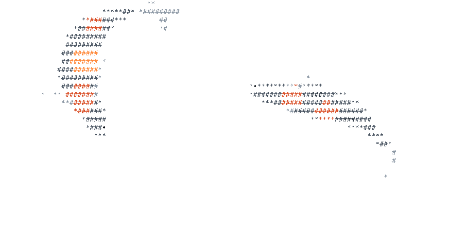

# ascii-koi

<picture>
  <source media="(prefers-color-scheme: dark)" srcset="docs/koi-dark.gif">
  
</picture>

Originally from [xiao.sh](https://x.com/inperspicuous/status/2077676490234224845).

ASCII koi fish swimming in an ASCII pond on a canvas. They glide in from the edges, rest, and leave wakes in the water.
No framework. The water comes from [ascii-pond](https://github.com/i098/ascii-pond), and the pond does the pointer work: it steers the koi away from the pointer.
The water stays clear by default; pass `ripples: true` to draw the waves.

## Install

```sh
npm install ascii-koi
```

The same version is on GitHub Packages as `@i098/ascii-koi` (add `@i098:registry=https://npm.pkg.github.com` to `.npmrc`).

## Usage

```ts
import { mountKoi } from "ascii-koi";

const koi = mountKoi(document.getElementById("hero")!);
// later
koi.destroy();
```

`mountKoi(target, options)` takes a `<canvas>` or any element. For an element, it adds a canvas that fills the element.

- The grid follows the size of the box. A resize starts a new pond, and the koi swim in again.
- The pond handles the pointer and steers the koi away from it.
- Drawing stops while the canvas is off-screen or the tab is hidden.
- With `prefers-reduced-motion: reduce`, it draws one still frame and ignores the pointer.

The options are the same as for `mountPond` in [ascii-pond](https://github.com/i098/ascii-pond#usage), except `scene`.

### The engine without the canvas

`KoiSim` is the simulation alone (typed arrays, no DOM), for terminals or your own renderer:

```ts
import { KoiSim } from "ascii-koi";

const sim = new KoiSim(80, 24);
sim.step(16);
sim.cell(10, 5); // { ch: "#", color: "#eef2f5" } over a koi, null over open water
sim.field; // wave heights, from ascii-pond
```

## Demo

```sh
npm install && npm run build
python3 -m http.server   # then open http://localhost:8000/demo/
```

## License

Apache-2.0
